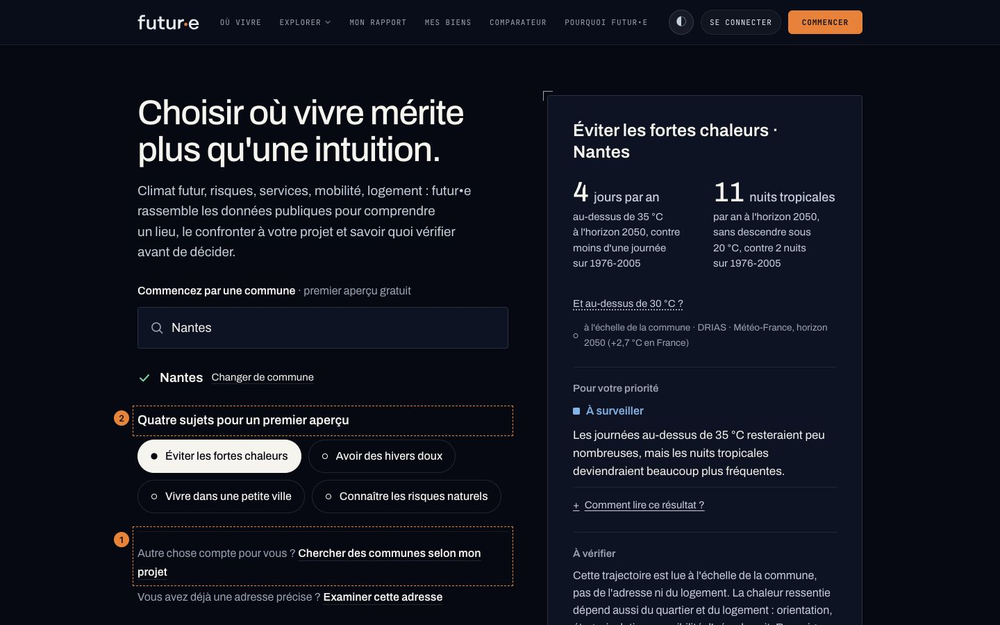
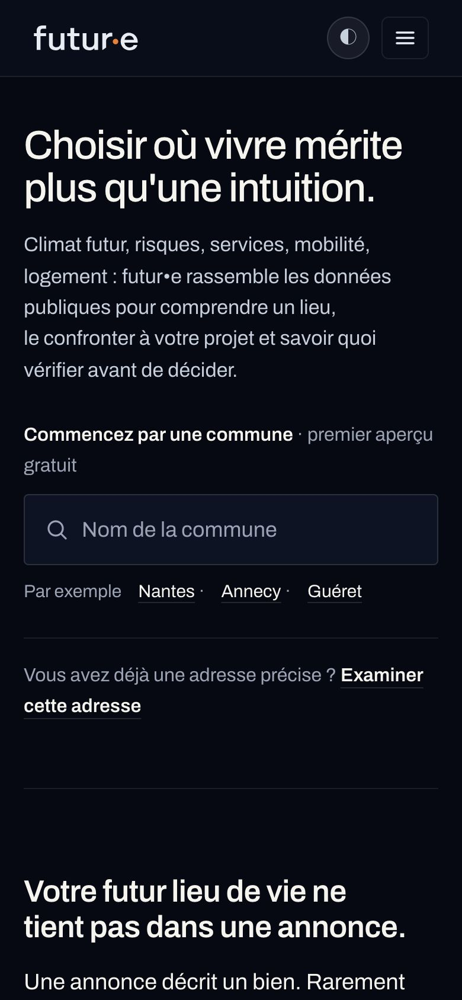
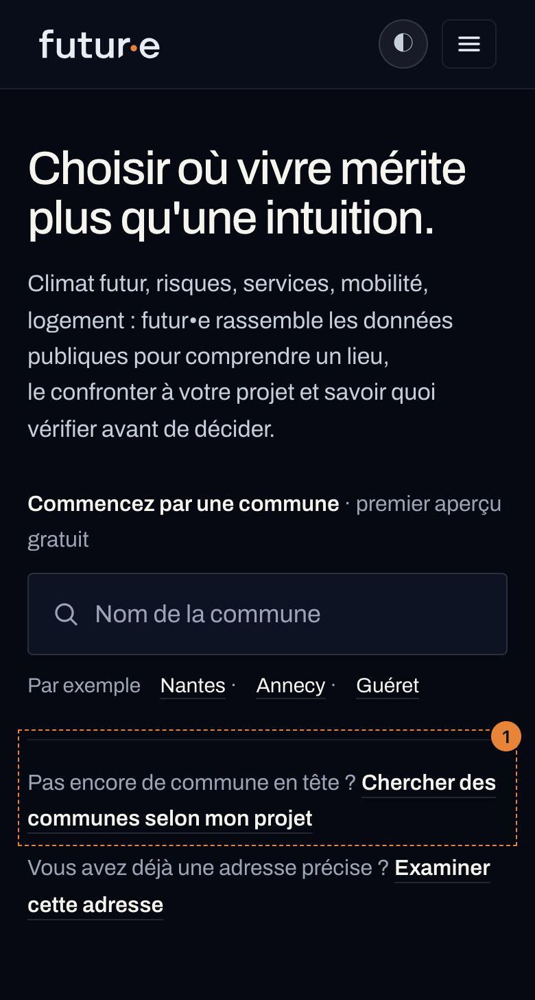
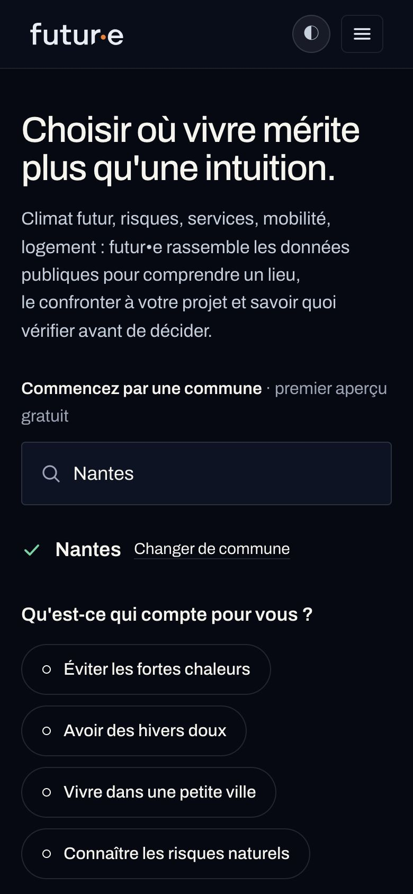
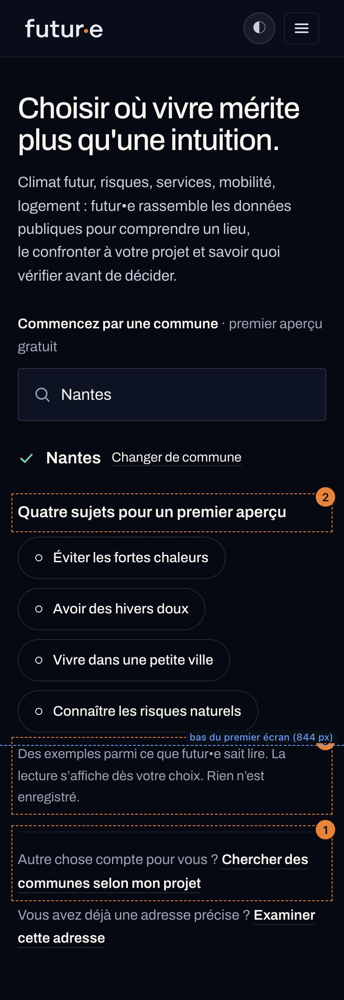
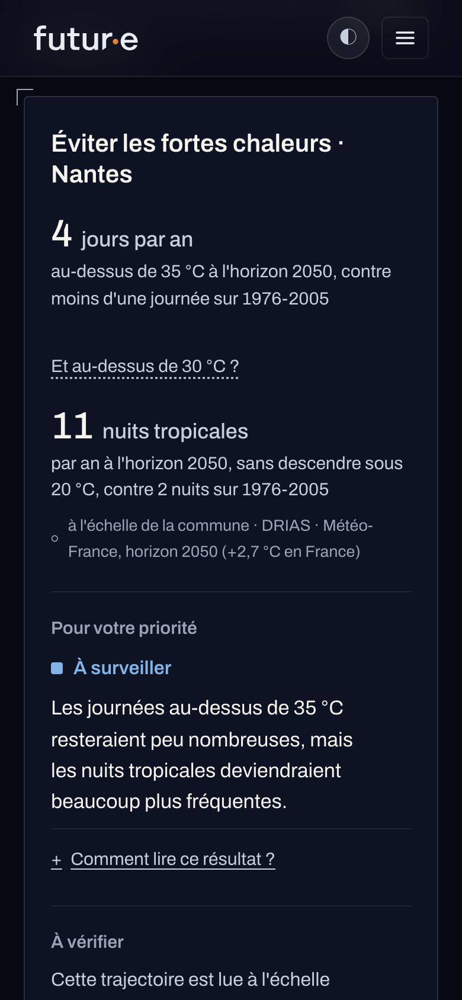
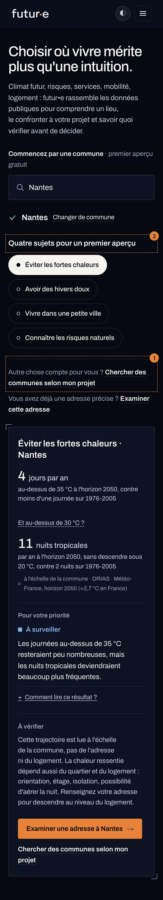

# FUT-113 · L'aperçu en quatre sujets et l'entrée par le Projet

19/10/2026 · audit et proposition, **sans implémentation**. Code lu sur `origin/main` (`8d02e190`, accueil FUT-50 en production), servi en local et capturé à 1440 px et 390 px. Les maquettes « après » sont le vrai accueil local dont les textes ont été modifiés **dans la page affichée** par le script de capture : aucun composant n'a été touché.

Captures : `docs/audits/2026-10-19-fut113-accueil-projet/` (`avant-*`, `apres-*`, `apres-*-annote`).

---

## 1. Diagnostic

**Le problème est réel.** Il est modéré pour la personne qui a une commune en tête, élevé pour celle qui part de son projet.

### Où il apparaît

| # | Constat | Mesure / preuve |
|---|---|---|
| D1 | **État A : aucune porte vers le Projet dans le héros.** Le sous-titre promet de « confronter [un lieu] à votre projet », mais les deux seules actions sont le champ commune et « Examiner cette adresse ». | Premier lien de la page vers `/ou-vivre` : **2 590 px** (ordinateur), **4 587 px** (390 px). C'est le bouton « Comparer trois territoires » du **comparatif à 39 €** : la seule mention de `/ou-vivre` dans la page la présente comme une comparaison payante. |
| D2 | **État B : une question ouverte, une réponse fermée.** « Qu'est-ce qui compte pour vous ? » appelle une réponse personnelle ; on propose quatre choix. Rien ne dit que ce sont des exemples. | `HeroLieu.tsx:338`. |
| D3 | **La même question désigne trois choses différentes.** Sur l'accueil : quatre pastilles. Sur `/ou-vivre` : le texte libre (« Découvrez où vivre, selon ce qui compte pour vous »). Dans le checkout du dossier : le Projet (`ContexteDuDossier.tsx:136`). La formule appartient au Projet ; l'accueil l'emprunte pour une démonstration. | |
| D4 | **« Choisissez-en une »** suggère un choix unique alors que les pastilles se cumulent (onglets dès deux choix). Mineur, mais il resserre encore l'impression de menu fermé. | `HeroLieu.tsx:350`, `basculer()`. |
| D5 | **État C : la porte Projet arrive trop tard et trop bas.** Elle n'apparaît qu'après avoir choisi une pastille, donc seulement pour ceux qui se sont reconnus dans l'une des quatre. C'est l'inverse du public visé. | Lien « Chercher des communes selon mon projet » à **1 027 px** sur un écran de 900 (sous le pli, après le bouton orange). À 390 px, environ 1 075 px sous le haut de l'écran après le défilement automatique. |
| D6 | **Le bloc des offres redit la confusion.** « Découverte » : « Regarder une commune **avec vos priorités**, ici même ». « Vos priorités » désigne alors les quatre pastilles. | `SectionsAccueil.tsx:157`. |
| D7 | La navigation donne bien « Où vivre » en premier, mais en petites capitales à chasse fixe sur ordinateur, et derrière le menu sur mobile. Ce n'est pas une porte de héros. | `config/navigation.ts:30`. |

**Repère FUT-50.** Le cadrage du 11/10 demandait deux portes visibles dès le premier écran : « Je cherche où vivre » → `/ou-vivre` et « J'ai déjà une adresse » → `/dossier`. La version C a ajouté le champ commune, gardé la porte adresse, et la porte Projet a glissé à l'état C. FUT-113 corrige cet écart sans rouvrir la décision « le lieu avant le Projet ».

### Les trois parcours, tels qu'ils fonctionnent réellement

| Parcours | Ce qui existe | Gratuit / payant | Ce qui est conservé |
|---|---|---|---|
| **1 · Je connais une commune** | Accueil : une commune, quatre lectures au grain communal (fait → pour cette priorité → à vérifier). Suite proposée : « Examiner une adresse à {commune} » (`/dossier`). | Gratuit. La commune lue depuis **son** projet, c'est le dossier de territoire à 14 € (« Une commune examinée depuis votre projet »). | Rien (« Rien n'est enregistré », exact). |
| **2 · Je pars de mon projet** | `/ou-vivre` : texte libre, environ 30 critères publics, cartes de territoires, synthèse, 2 questions AskFuture. Sortie : « Explorer le rapport · 14 € » par territoire, comparatif à 39 € à trois communes. Amorce « Partez d'une commune que vous aimez » (communes **semblables**, aucune lecture de la commune elle-même). | Recherche gratuite, sans compte. | Instantané local de session, **2 h** (`futuree:ouvivre:session`), pour survivre au retour d'un paywall. **Aucun Projet durable** : c'est une Recherche temporaire (FUT-27). |
| **3 · J'ai une adresse** | `/dossier` : qualification de l'adresse, périmètre et prix expliqués, 39 € (25 € après un dossier de territoire). | Payant. | Le dossier, dans le compte. |

**Ce que `/ou-vivre` ne fait pas**, et qu'aucun texte ne doit laisser croire : il ne relit pas la commune choisie sur l'accueil (aucun transfert), il n'enregistre aucun Projet, il ne couvre que l'Hexagone et la Corse, et il n'affiche aucun chiffre climatique (frontière voulue avec le rapport).

### Gravité par profil

- **Profil 1 (une commune en tête)** : modérée. Il obtient un aperçu réel ; le risque est de conclure « futur•e ne sait lire que quatre choses » et de partir.
- **Profil 2 (un projet, pas de commune)** : élevée. Le héros lui demande une commune qu'il n'a pas ; sa porte est à 2 590 px, sous un libellé de comparaison payante.
- **Profil 3 (une adresse)** : faible. La porte est visible dès l'état A (556 px ordinateur, 561 px mobile).

---

## 2. Ce qui fonctionne et doit rester

- Le lieu d'abord, un vrai champ, des communes à essayer, **aucun résultat avant le choix** (décision du 14/10).
- La lecture en trois temps, source, horizon et grain visibles : c'est la meilleure preuve du raisonnement de futur•e.
- « premier aperçu gratuit » sur le libellé du champ : la promesse de gratuité est déjà juste et bien placée.
- « Rien n'est enregistré » : exact, à garder.
- La porte adresse séparée, discrète, retirée pour l'outre-mer.
- Le libellé « Chercher des communes selon mon projet » (revue du 15/10) : il dit exactement ce que fait `/ou-vivre`. On le garde **mot pour mot**, on change seulement sa place.
- Le geste d'ouverture à l'état C (colonne qui s'ouvre) : rien dans la proposition ne le touche.

---

## 3. Deux options

### Option A · recommandée · une seconde porte et trois phrases

Trois changements dans le héros, un dans les offres. Aucun nouvel état, aucun nouveau composant, aucune saisie libre sur l'accueil.

**① La porte Projet rejoint la porte adresse, dès l'état A.** Le filet du bas du bloc porte désormais deux lignes, de même poids :

| État | Ligne 1 (nouvelle) | Ligne 2 (inchangée) |
|---|---|---|
| A · vierge | « Pas encore de commune en tête ? **Chercher des communes selon mon projet** » | « Vous avez déjà une adresse précise ? **Examiner cette adresse** » |
| B · commune | « Autre chose compte pour vous ? **Chercher des communes selon mon projet** » | idem |
| C · lecture | idem B | idem |

L'amorce change entre A et B parce que la question change : en A, la personne n'a peut-être pas de commune ; en B et C, elle en a une et ne se reconnaît peut-être pas dans les quatre sujets. Le lien, lui, ne change jamais et dit ce qu'il fait : **chercher des communes**. Il ne promet pas de relire Nantes.

**② Le titre du bloc des pastilles** (états B et C)

> Avant : « Qu'est-ce qui compte pour vous ? »
> Après : **« Quatre sujets pour un premier aperçu »**

Il dit le nombre, la nature (des sujets d'aperçu) et rend la question « Qu'est-ce qui compte pour vous ? » au Projet, là où elle est posée ailleurs (D3).

**③ L'aide sous les pastilles** (état B seulement, comme aujourd'hui)

> Avant : « Choisissez-en une : la lecture s'affiche aussitôt. Rien n'est enregistré. »
> Après : **« Des exemples parmi ce que futur•e sait lire. La lecture s'affiche dès votre choix. Rien n'est enregistré. »**

« Des exemples parmi ce que futur•e sait lire » porte le critère de réussite du ticket. Le singulier disparaît (D4). La gratuité reste dite une fois, sur le libellé du champ.

**④ L'offre Découverte** (`SectionsAccueil.tsx:157`, même promesse, autre point de citation)

> Avant : « Regarder une commune avec vos priorités, ici même »
> Après : **« Un premier aperçu d'une commune sur quatre sujets, ici même »**

La ligne suivante (« Décrire votre projet et voir les territoires qui y répondent ») est juste et reste.

**Inchangé** : le titre du héros, le sous-titre, le libellé du champ, les communes d'exemple, les quatre pastilles, la carte de lecture et ses deux suites (bouton orange « Examiner une adresse à {commune} », lien « Chercher des communes selon mon projet » en fin de carte : sur mobile, c'est le dernier geste après la lecture, il garde son utilité).

**Outre-mer.** Pour une commune ultramarine, la ligne adresse se retire déjà. Je propose de retirer **aussi** la ligne Projet aux états B et C : `/ou-vivre` ne cherche qu'en Hexagone et Corse, et l'amorce « Autre chose compte pour vous ? » laisserait croire à une recherche autour de cette commune. En A, la ligne reste (aucune commune n'est encore choisie).

**Typographie.** Lier « mon projet » et « cette adresse » par une espace insécable (`fr()` / `bindOrphans`) : à 534 px de colonne (état C), « projet » tombe seul sur la ligne suivante dans la maquette.

### Option B · plus expressive · un sommaire de trois départs

À n'envisager que si l'option A ne suffit pas aux tests.

```
État A
┌────────────────────────────────────────────────┐
│ Choisir où vivre mérite plus qu'une intuition. │
│ Climat futur, risques… (inchangé)              │
│                                                │
│ Par où commencer ?                             │
│ ● Une commune      [ Nom de la commune      ]  │
│                    Par exemple Nantes · …      │
│ ○ Mon projet       Chercher des communes  →    │
│ ○ Une adresse      Examiner cette adresse →    │
└────────────────────────────────────────────────┘

État B : comme l'option A, plus une 5e pastille en pointillé
( Éviter les fortes chaleurs ) ( Avoir des hivers doux )
( Vivre dans une petite ville ) ( Connaître les risques naturels )
( ┄ Autre chose ? Décrire mon projet ↗ ┄ )
```

Gain : les trois intentions du ticket sont nommées en une ligne chacune, et la 5e pastille attrape la personne au moment exact où elle ne se reconnaît pas.

Pourquoi je ne la recommande pas pour la V1 :
- elle **retouche la composition validée** de FUT-50 (le champ cesse d'être l'action dominante et unique du premier écran) ; on glisse vers une « version D » ;
- la 5e pastille a l'apparence d'un choix et le comportement d'une navigation : on clique pour ajouter un critère à Nantes, on quitte la page pour une recherche de communes. C'est précisément la fausse attente que le ticket interdit ;
- le gain sur A est marginal : A rend déjà la porte visible dès le premier écran, ordinateur et mobile.

---

## 4. Recommandation

**Option A.** Elle répond au critère de réussite par les mots (« quatre sujets pour un premier aperçu », « des exemples parmi ce que futur•e sait lire ») et par la place (la porte Projet visible avant toute pastille). Elle restaure les deux portes demandées par FUT-50 sans toucher au geste de la version C. Elle ne promet rien qui n'existe pas : le lien garde le libellé validé le 15/10, aucune sauvegarde n'est annoncée, aucune commune n'est transmise.

---

## 5. Avant / après

Positions mesurées (haut de l'élément, pli à 900 px sur ordinateur, 844 px à 390 px).

| | Porte Projet avant | Porte Projet après |
|---|---|---|
| A · 1440 | 2 590 px (offres, « Comparer trois territoires ») | 533 px, au-dessus du pli |
| A · 390 | 4 587 px | 538 px, au-dessus du pli |
| B · 1440 | 2 829 px | 797 px, au-dessus du pli |
| B · 390 | 4 967 px | 942 px, juste sous le pli, directement après les pastilles et l'aide |
| C · 1440 | 1 027 px (fin de la carte, sous le pli) | 765 px dans la colonne gauche, au-dessus du pli ; le lien de fin de carte reste |
| C · 390 | 1 075 px sous l'écran après défilement | 856 px, au-dessus de la lecture (le défilement automatique la dépasse), et toujours en fin de carte |

Limite à 390 px, état B : les quatre pastilles occupent l'écran, la porte Projet tombe juste sous le pli. C'est acceptable : elle suit immédiatement les pastilles, au lieu d'attendre 4 000 px plus bas, et l'état A (celui qu'on voit en arrivant) la montre au-dessus du pli.

| État | Avant | Après (annoté) |
|---|---|---|
| A · ordinateur |  |  |
| B · ordinateur |  |  |
| C · ordinateur |  |  |
| A · 390 |  |  |
| B · 390 |  |  |
| C · 390 |  |  |

Annotations : ① porte Projet · ② titre du bloc · ③ aide. Les versions sans annotation sont `apres-{a,b,c}-{1440,390}.jpg`. Les captures « avant » à 390 px montrent le premier écran ; les « après » à 390 px montrent le héros entier, avec le pli en pointillé bleu.

---

## 6. Risques et limites

**Promesse de personnalisation.** « Des exemples parmi ce que futur•e sait lire » est vrai : `/ou-vivre` lit une trentaine de critères, les dossiers davantage. Le texte ne dit pas que ces lectures sont gratuites sur l'accueil, et le lien dit « chercher des communes ». Risque résiduel : une personne attachée à Nantes clique en espérant voir Nantes relue selon son projet. Le libellé l'en avertit ; la réponse exacte à son besoin est le dossier de territoire à 14 €, que le héros ne propose pas (voir décision 4 ci-dessous).

**Recherche temporaire / Projet durable.** Rien dans les textes proposés n'évoque d'enregistrement. « Rien n'est enregistré » reste exact pour l'accueil. `/ou-vivre` garde une session de 2 h dans le navigateur : ce n'est pas un Projet et aucun texte du héros ne le présente comme tel.

**Gratuit / payant.** Aucun contenu payant n'est ajouté à l'accueil. La seule mention d'un prix reste dans le parcours `/dossier` et dans les offres.

**Cannibalisation du dossier de territoire (14 €).**
- *Fait observé* : le héros ne mène jamais directement au dossier de territoire. Les accès gratuits vers lui sont les cartes de résultats de `/ou-vivre` (« Explorer le rapport · 14 € ») et le bloc des offres.
- *Fait observé* : l'option A n'ajoute aucune lecture gratuite. Elle présente au contraire l'aperçu comme partiel (« premier aperçu », « des exemples »), ce qui rend plus lisible ce qu'apporte le dossier (« la commune en entier »).
- *Hypothèse à tester* : rendre `/ou-vivre` visible dès l'état A augmente le passage par la recherche, donc l'exposition à l'offre à 14 €.
- *Limite de mesure* : aucun événement nommé ne suit aujourd'hui le héros (`SuiviTarifs` n'émet que `pricing_page_viewed`). Sans ajout, l'effet ne pourra pas être distingué du trafic, très faible tant que `robots.txt` reste fermé.

**Hors périmètre, relevés pendant l'audit** (aucun ticket créé) :
- Le bouton orange de la navigation, « Commencer », mène à `/inscription`, pas à un parcours (FUT-86).
- `/ou-vivre` parle encore de « Pack Décision · 39 € » et d'« Explorer le rapport · 14 € » alors que l'accueil dit « Dossier comparatif » et « Dossier de territoire » ; il annonce « les 34 000 communes de France métropolitaine » quand l'accueil, corrigé, dit 34 788.
- La description du site (`app/layout.tsx`) reste « Projection climatique personnelle », le positionnement que FUT-50 voulait quitter.

---

## 7. Périmètre d'implémentation estimé (non réalisé)

Petit : une demi-journée avec les vérifications.

| Fichier | Changement |
|---|---|
| `src/components/accueil/HeroLieu.tsx` | titre (l. 338), aide (l. 350), la porte devient deux lignes avec l'amorce selon l'état ; masquage des deux lignes pour une commune d'outre-mer aux états B et C ; espaces insécables. ~15 lignes. |
| `src/components/accueil/accueil.module.css` | `.porteAdresse` devient un bloc de deux lignes (`display: grid; gap: 10px`), filet en haut seulement. ~3 lignes. |
| `src/components/accueil/SectionsAccueil.tsx` | l. 157, offre Découverte. 1 ligne. |
| *(facultatif)* | deux événements PostHog : clic sur la porte Projet (avec l'état A/B/C) et sur la porte adresse. Sans eux, l'hypothèse du § 6 reste invérifiable. |

Vérifications à prévoir : captures 1440 / 820 / 390 / 360 des trois états ; ordre de tabulation (champ → exemples → pastilles → porte Projet → porte adresse) ; commune d'outre-mer (aucune des deux portes en B et C) ; le prototype `/dev/fut50/c` monte le même composant et changera avec lui ; `scripts/fut50/interactions-c.mjs` cite les anciens textes et sera à mettre à jour s'il est encore utilisé.

Aucune règle moteur, aucune route, aucune donnée, aucun prix ne change.

---

## Décisions demandées au porteur

1. **Option A** telle quelle ? (recommandé)
2. L'amorce des états B et C : « Autre chose compte pour vous ? » (proposée) ou garder « Pas encore de commune en tête ? » partout (un seul texte, mais il parle moins à la personne qui ne se reconnaît pas dans les quatre sujets).
3. Retirer la ligne Projet pour une commune d'outre-mer aux états B et C ? (recommandé)
4. Le dossier de territoire à 14 € reste-t-il **absent** du héros ? Je recommande oui pour la V1 : ajouter un appel à l'action multiplierait les portes, et le bloc des offres le présente déjà.
5. Ajouter les deux événements de mesure dans la même PR ?

---

## Décision du 19/10 et prototype

**Option A épurée, validée.** L'aide sous les quatre sujets est **supprimée entièrement** (y compris « Rien n'est enregistré ») : le titre dit déjà qu'il s'agit d'un premier aperçu, les boutons disent qu'il faut en choisir un, et la porte Projet montre la profondeur. Règle éditoriale retenue : *montrer une possibilité, pas expliquer trois fois comment l'utiliser.*

Arbitrages : amorce « Pas encore de commune en tête ? » sans commune, « Autre chose compte pour vous ? » avec une commune ; outre-mer : les deux portes **et** le lien de fin de lecture se retirent (la carte dit déjà que les dossiers couvrent l'Hexagone et la Corse) ; dossier de territoire absent du héros ; deux événements PostHog.

Intégré sur la branche `bonjourfuturee/fut-113-clarifier-lapercu-en-quatre-sujets-et-lentree-par-projet-sur` (validation définitive du porteur, 19/10) :
- `HeroLieu.tsx` : titre, aide retirée, bloc `portes` (deux lignes, amorce selon l'état), retrait outre-mer, lien de fin de lecture retiré hors offre, événements `accueil_sujet_choisi {cle}` et `accueil_porte_projet_clicked {etat: vierge | commune | priorite | fin_de_lecture}` ;
- `accueil.module.css` : `.porteAdresse` remplacé par `.portes` / `.porte` ;
- `SectionsAccueil.tsx` : offre Découverte.

Vérifié : `tsc` et `eslint` propres, 102 tests de l'accueil verts ; parcours joué dans le navigateur (Nantes, A → B → C, 1440 et 390 px ; Fort-de-France : aucune porte ni lien vers `/ou-vivre` ; clic sur la porte Projet → `/ou-vivre`).

Positions mesurées de la porte Projet (prototype) : A 556 px (1440) / 561 px (390) ; B 759 / **879** ; C 788 dans la colonne (1440).

**Mobile, état B :** la porte arrive à 879 px pour un écran de 844, juste après le quatrième sujet. Le pli réel d'un téléphone est plus haut encore (barres du navigateur), donc aucune retouche d'espacement ne la garantirait au-dessus. La garantie tenue est l'**ordre** : elle est la toute première chose sous les quatre sujets, et elle est visible sans défiler à l'arrivée (état A).

Captures : `proto-{a,b,c}-{1440,390}.jpg`, `proto-outremer-c-1440.jpg`.
