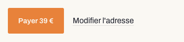
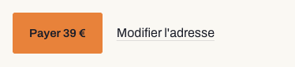

# FUT-118 R0 · Preuve d'absence de changement visible

20 octobre 2026 · branche `feat/fut-118-convergence-releve`, lot R0 (consolidation du canon). Avant :
`7cb9ef1a` (phase A corrigée). Après : le commit R0.

## Ce que R0 change dans le code

| Fichier | Changement | Effet attendu à l'écran |
| --- | --- | --- |
| `src/app/design-tokens.css` | les jetons `--r-*` montent du module CSS vers `:root`, **aux mêmes valeurs** ; ajout des rôles `--r-t-*`, des largeurs `--r-titre` et `--r-chiffre`, et de `--r-sur-marque` | aucun |
| `src/components/releve/releve.module.css` | ne déclare plus les jetons ; consomme les rôles `--r-t-*` (mêmes valeurs) ; `.boutonMarque` prend `--r-sur-marque` ; en-tête « canon » | aucun, **sauf** le texte du bouton de marque en thème clair (contraste 2,57:1 → 6,15:1) |
| `src/components/releve/primitives.tsx`, `src/components/report/kit.tsx` | commentaires d'en-tête (canon ; déprécié) | aucun |
| `src/components/releve/heritage.ts`, `heritage-reference.json`, `canon.test.ts` | test-cliquet, source unique des jetons, jetons définis, contrastes, en-têtes | aucun (tests) |
| `DESIGN.md`, `AGENTS.md` | v3.0 ; convention « une seule grammaire » | aucun (documents) |

`.boutonMarque` n'est employé par **aucune page de production** (seulement par des bancs et des
témoins de développement).

## Méthode

`scripts/fut118/empreinte-visuelle.mjs`, puis `scripts/fut118/comparer-empreintes.mjs`.

- **13 pages × 2 largeurs (1440, 390) × 2 thèmes (sombre, clair forcé par `data-theme`) = 52 captures**,
  pleine page, densité 1.
- Pour chaque capture : **les pixels** (tolérance zéro) et **le style calculé de chaque élément visible**
  (couleur, fond, police, graisse, axe de largeur, taille, interligne, espacement des lettres, casse,
  marges, bordures, rayon, ombre, opacité, affichage, grille, contour, boîte, pseudo-éléments).
- Pages : l'accueil de production ; **Ma décision classique** et **Ma décision sous le Relevé**, chacune
  au repos et avec un projet changé et une adresse indisponible (composants de production sur un
  dossier réel du moteur, banc `/dev/fut91`) ; le gabarit de `/rapport` avec le Relevé (banc
  `/dev/fut92`) ; Logement en production (blocs de production, logement fictif) et en prototype
  Relevé ; une page commune publique ; la qualification d'adresse ; la connexion ; deux témoins.
- Serveur de développement local, sans clé de modèle (`DOSSIER_NARRATIVE=false`), Chrome sans tête,
  mouvement réduit, **animations et transitions figées dans les deux passes**, bandeau des bancs de
  développement masqué dans les deux passes (il n'existe pas en production).
- **Le bruit est mesuré d'abord** : deux passes « avant » sur le même code, comparées entre elles.

## Bruit de mesure (même code, deux passes)

**0 propriété différente sur 52 captures** : le style calculé est entièrement déterministe. Trois
captures portent un bruit de pixels sans aucune différence de style : l'accueil à 390 px en sombre
(photographie chargée en différé, 241 152 pixels), la connexion à 1440 px en sombre et à 390 px en clair
(171 551 et 124 777 pixels : le rendu de trois **flous de 90 px**, `.auth-shell-orb`, varie d'une passe à
l'autre ; ces orbes sont immobiles). D'une passe à l'autre, ce bruit se déplace : on le retrouve aussi,
en moindre quantité, sur la page commune et sur Ma décision (4 à 48 176 pixels, toujours sans aucune
différence de style).

**Correction du 20/10 (revue de R0).** La première version de ce document affirmait que les fonds de la
connexion, des pages commune et du gabarit de `/rapport` « continuent de bouger en mouvement réduit ».
Vérification faite dans le code, c'est vrai pour les **pages commune** seulement : leurs orbes `breathe`
bougent en boucle sans garde. Les orbes de la connexion et de `/rapport` sont **immobiles** ; leur bruit de
pixels vient du rendu de leur flou. La liste exacte des animations qui ignorent le mouvement réduit, et
leurs lots de rattachement (R2, R6, R7, R8, R9, R11), est dans `DESIGN.md` § 15.4.
## Résultat : avant R0 → après R0

| Capture | Pixels différents | Éléments | Propriétés différentes |
| --- | --- | --- | --- |
| accueil-1440-dark | 0 / 5496480 | 178 → 178 | 0 |
| accueil-1440-light | 0 / 5496480 | 178 → 178 | 0 |
| accueil-390-dark | 0 / 2692560 | 168 → 168 | 0 |
| accueil-390-light | 0 / 2692560 | 168 → 168 | 0 |
| connexion-1440-dark | 171551 / 1497600 | 61 → 61 | 0 |
| connexion-1440-light | 0 / 1497600 | 61 → 61 | 0 |
| connexion-390-dark | 0 / 528450 | 61 → 61 | 0 |
| connexion-390-light | 0 / 528450 | 61 → 61 | 0 |
| decision-classique-1440-dark | 0 / 2782080 | 203 → 203 | 0 |
| decision-classique-1440-light | 4 / 2782080 | 203 → 203 | 0 |
| decision-classique-390-dark | 0 / 1026870 | 193 → 193 | 0 |
| decision-classique-390-light | 0 / 1026870 | 193 → 193 | 0 |
| decision-classique-etats-1440-dark | 0 / 3060000 | 213 → 213 | 0 |
| decision-classique-etats-1440-light | 10 / 3060000 | 213 → 213 | 0 |
| decision-classique-etats-390-dark | 0 / 1138800 | 203 → 203 | 0 |
| decision-classique-etats-390-light | 0 / 1138800 | 203 → 203 | 0 |
| decision-releve-1440-dark | 0 / 3896640 | 318 → 318 | 0 |
| decision-releve-1440-light | 0 / 3896640 | 318 → 318 | 0 |
| decision-releve-390-dark | 9 / 1398930 | 308 → 308 | 0 |
| decision-releve-390-light | 0 / 1398930 | 308 → 308 | 0 |
| decision-releve-etats-1440-dark | 0 / 4171680 | 328 → 328 | 0 |
| decision-releve-etats-1440-light | 0 / 4171680 | 328 → 328 | 0 |
| decision-releve-etats-390-dark | 0 / 1510470 | 318 → 318 | 0 |
| decision-releve-etats-390-light | 0 / 1510470 | 318 → 318 | 0 |
| logement-production-1440-dark | 0 / 7502400 | 431 → 431 | 0 |
| logement-production-1440-light | 0 / 7502400 | 431 → 431 | 0 |
| logement-production-390-dark | 0 / 2464814 | 421 → 421 | 0 |
| logement-production-390-light | 0 / 2464814 | 421 → 421 | 0 |
| logement-prototype-releve-1440-dark | 0 / 5342400 | 360 → 360 | 0 |
| logement-prototype-releve-1440-light | 0 / 5342400 | 360 → 360 | 0 |
| logement-prototype-releve-390-dark | 0 / 2180880 | 349 → 349 | 0 |
| logement-prototype-releve-390-light | 0 / 2180880 | 349 → 349 | 0 |
| page-commune-chaleur-1440-dark | 0 / 5844960 | 202 → 202 | 0 |
| page-commune-chaleur-1440-light | 48176 / 5844960 | 202 → 202 | 0 |
| page-commune-chaleur-390-dark | 0 / 2527980 | 192 → 192 | 0 |
| page-commune-chaleur-390-light | 0 / 2527980 | 192 → 192 | 0 |
| qualification-1440-dark | 0 / 1296000 | 34 → 34 | 0 |
| qualification-1440-light | 0 / 1296000 | 34 → 34 | 0 |
| qualification-390-dark | 0 / 351000 | 24 → 24 | 0 |
| qualification-390-light | 0 / 351000 | 24 → 24 | 0 |
| rapport-gabarit-releve-1440-dark | 0 / 5447520 | 385 → 385 | 0 |
| rapport-gabarit-releve-1440-light | 0 / 5447520 | 385 → 385 | 0 |
| rapport-gabarit-releve-390-dark | 0 / 1851720 | 375 → 375 | 0 |
| rapport-gabarit-releve-390-light | 0 / 1851720 | 375 → 375 | 0 |
| temoin-paiement-1440-dark | 0 / 1320480 | 111 → 111 | 0 |
| temoin-paiement-1440-light | 476 / 1320480 | 111 → 111 | 2 |
| temoin-paiement-390-dark | 0 / 476580 | 101 → 101 | 0 |
| temoin-paiement-390-light | 476 / 476580 | 101 → 101 | 2 |
| temoin-territoire-1440-dark | 0 / 3664800 | 288 → 288 | 0 |
| temoin-territoire-1440-light | 0 / 3664800 | 288 → 288 | 0 |
| temoin-territoire-390-dark | 0 / 1348620 | 278 → 278 | 0 |
| temoin-territoire-390-light | 0 / 1348620 | 278 → 278 | 0 |

**Lecture.**

- **45 captures sur 52 sont identiques au pixel près**, et **50 sur 52 ont un style calculé identique**
  (les deux autres sont le témoin de paiement en thème clair, ci-dessous).
- **Accueil** (8 captures) : identique au pixel et au style.
- **Ma décision classique** (8 captures) : style identique ; 4 et 10 pixels de bruit sur deux captures
  en thème clair, du même ordre que le bruit mesuré entre deux passes identiques.
- **Ma décision sous le Relevé** (8 captures) et **gabarit de `/rapport` avec le Relevé** (4 captures) :
  style identique ; 9 pixels de bruit sur une capture.
- **Logement**, production et prototype, **qualification**, **connexion**, **page commune** : style
  identique ; les seuls écarts de pixels sont ceux du bruit mesuré.
- **Le seul changement réel** : le texte du bouton « Payer 39 € » du témoin de paiement, **en thème
  clair seulement**, passe de `rgb(250, 248, 243)` à `rgb(26, 29, 40)` (476 pixels, deux propriétés :
  couleur et couleur de contour). C'est la correction de contraste prévue (2,57:1 → 6,15:1). En thème
  sombre, la valeur est inchangée.

| Avant (thème clair) | Après (thème clair) |
| --- | --- |
|  |  |

**Un écart trouvé et écarté pendant la mesure.** Sans le masquage du bandeau des bancs, Ma décision
classique et le gabarit `/rapport` montraient 300 à 450 propriétés différentes. Toutes sont dans le
`BandeauPrototype` des bancs : posé hors de toute racine `.releve`, il employait des jetons `--r-*`
indéfinis (donc ignorés) ; une fois les jetons globaux, il reçoit ses vraies couleurs et un filet
pointillé de 1 px, qui décale le reste de la page d'un pixel. Ce bandeau n'existe qu'en développement.

## Contrôles du lot

| Contrôle | Résultat |
| --- | --- |
| Suite complète, lancée seule, deux fois | **2857 / 2857** (2852 avant R0, + 5 tests du canon) |
| `tsc --noEmit` | 0 erreur |
| ESLint sur les fichiers touchés | 0 signalement |
| `npm run build` | réussi ; les jetons `--r-t-*` et `--r-sur-marque` sont dans la feuille compilée |
| `next start` | `/` 200 ; `/dev/fut118`, `/dev/fut118/paiement`, `/dev/fut91` : 404 |
| Mutations | jeton clair rétabli à `#faf8f3` → K4 échoue (2,57:1) ; fichier nouveau avec `glass` → K1 échoue ; jeton redéclaré dans le module → K2 échoue |

## Seconde passe (relecture de R0, conventions)

La passe de relecture ne modifie, dans le code de rendu, que des commentaires (`primitives.tsx`,
`heritage.ts`) ; le reste touche des tests (`canon.test.ts`, `heritage-exceptions.json`) et des
documents. Empreinte refaite et comparée au même « avant » : **même résultat**. Le style calculé est
identique sur 50 captures sur 52 ; les deux autres sont le bouton de marque du témoin, en thème clair, comme
ci-dessus. Les pixels diffèrent seulement par le bruit déjà mesuré (connexion : flou ; Ma décision
classique : 4 et 10 pixels). Suite complète, lancée seule deux fois : **2858 / 2858** (+ K1b) ; tests du
mouvement (G1, G2, Q4) et du canon (K1 à K5, K1b) au vert ; `tsc` et ESLint sans erreur.

## Troisième passe : Archivo en largeur normale (21/10)

Le fichier Archivo servi par le site n'a pas d'axe de largeur (un même texte mesure 668 px à `wdth` 62,
100 et 125 ; l'Archivo de Google Fonts varie de 453 à 851 px). Les 32 réglages `wdth` et les 4 jetons de
largeur, inopérants, sont retirés ; la référence devient Archivo en largeur normale (choix du porteur).

Retirer `font-variation-settings` change **volontairement** une propriété calculée : l'identité absolue
des styles n'est donc pas attendue. Comparaison avant / après (52 captures) :

- **Pixels** : identiques sur toutes les captures, hors bruit déjà mesuré (connexion, flou ; 59 pixels sur
  une capture de Ma décision sous le Relevé à 390 px en clair). Dimensions de page, retours à la ligne et
  compositions inchangés (les boîtes de chaque élément sont comparées et identiques).
- **Styles calculés** : toutes les différences portent sur **une seule propriété**,
  `font-variation-settings` (`"wdth" 118` et autres → `normal`), sur l'accueil (8 éléments par capture),
  Ma décision sous le Relevé et le gabarit `/rapport` (30), le prototype Logement (31) et les témoins.
  Aucune autre propriété ne change.

Contrôles : suite complète lancée seule deux fois, **2859 / 2859** (+ K6) ; `tsc` et ESLint sans erreur ;
K6 vérifié par mutation (un réglage `wdth` réintroduit fait échouer le test).

## Limites : ce que cette preuve ne valide pas

**Elle prouve qu'R0 ne change rien à l'écran. Elle ne valide pas l'interface.** Les contrôles suivants
restent obligatoires avant l'activation publique de chaque surface migrée (`DESIGN.md` § 14, plan du
rapport § E) : Safari / WebKit, thème clair relu à l'œil, écrans connectés avec une vraie session et de
vrais dossiers, mouvement réduit, mobile 360 et 390 px, écran non-Retina, clavier.

- Les captures sont faites **animations figées** : elles ne disent rien du comportement en mouvement,
  normal ou réduit.
- Mesure sur **Chrome** seulement ; Safari et Firefox non mesurés (aucun moteur WebKit disponible).
- Serveur de **développement** : le build de production a été vérifié séparément (compilation, présence
  des jetons, 404 des bancs), pas capturé.
- Les écrans connectés réels (`/rapport` avec une session) ne sont pas capturés : leurs composants le
  sont, par les bancs qui montent les composants de production.
- Le thème clair est capturé en forçant `data-theme="light"` ; il n'a jamais été relu à l'œil.
