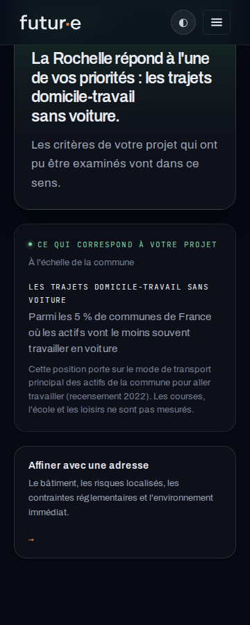
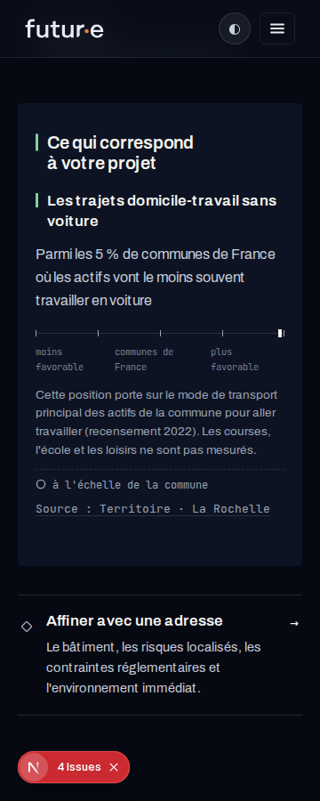

# FUT-96 — Limitations des correspondances favorables

22 octobre 2026. Correctif de restitution après la PR #78, PR corrective #81.

## Périmètre

Le classique affiche `f.limitation` si elle existe ; le Relevé transmet ce même champ à sa nuance existante. Aucun nouveau texte métier, calcul, règle, score, classement, donnée ou artefact. Aucun appel Anthropic ni écriture utilisateur. Les versions historiques ne sont pas régénérées ni modifiées : seul leur rendu montre maintenant une limitation lorsqu’elles en possèdent déjà une.

## Preuves de rendu

Quatre tests permanents dans `src/lib/fut96-limitations-rendu.test.ts` rendent le vrai `DossierDecisionSection`, classique et Relevé, sur un dossier favorable mobilité assemblé hors ligne. Ils vérifient la phrase de rang, la limitation exacte rendue en paragraphe visible, l’absence de mutation du dossier et l’absence de nuance artificielle quand le champ n’existe pas.

Commande : `node --test src/lib/fut96-limitations-rendu.test.ts`.
Suite complète : 2 940/2 940. TypeScript (`npx tsc --noEmit`) et lint des trois fichiers modifiés réussis. Build Vercel de 64135f17 : READY (compilation, TypeScript et génération des pages). Le build local compile et valide TypeScript mais ne termine pas sans les variables Supabase à la collecte des pages ; aucune variable ni secret de production n’a été chargé pour le contourner.

## Vérification visuelle

Banc existant `/dev/fut91`, composants de production, commune La Rochelle et priorité `faible_dependance_auto:3`, sans adresse ni compte :

- `/dev/fut91?insee=17300&prefs=faible_dependance_auto:3&adresse=0&vue=classique&etat=pending`
- Même URL avec `vue=releve`.

Serveur local avec `DOSSIER_NARRATIVE=false`. Chromium 153, largeurs 360, 390 et 1440 px, thèmes clair et sombre, tactile émulé sur mobile : 12 cas. La limitation est visible dans le corps du constat, hors détails fermés, sans débordement horizontal (0 px partout). 13 px dans le classique ; nuance existante du Relevé. Inspection des captures mobile et bureau : texte intégral, aucun chevauchement. Il s’agit d’une émulation, pas d’une recette Android physique.

## Limite du contrôle de production

Ne pas ouvrir un dossier authentifié susceptible de générer automatiquement une conclusion. La preuve de restitution utilise les composants de production sur le banc local et la fixture permanente, puis la correspondance entre le commit livré et le déploiement READY. Elle ne constitue pas une lecture d’un dossier client en production. Aucun dossier généré pour cette vérification. Le résultat du déploiement et les contrôles publics sont consignés dans FUT-96 après fusion.
