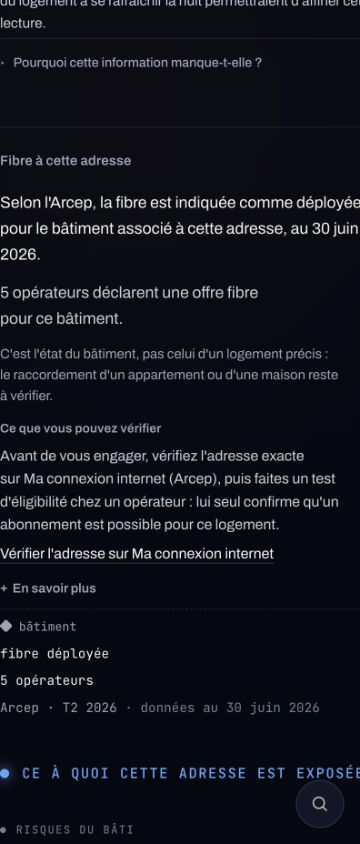

# FUT-162 — correction responsive minimale (PR en brouillon)
29 octobre 2026. Base : `760955985dbb773957745332d21bb06208043969`.

## Cause mesurée dans le vrai Logement
Session de recette, 11 place Blair à Saintes, dossier de test créé lors de FUT-156. Viewport CSS observé : **360 px**, `devicePixelRatio=1,100000023841858` (zoom/contexte navigateur à 110 % ; la largeur réelle est contrôlée, pas déduite de la largeur demandée).
Le texte du titre « Ce à quoi cette adresse est exposée » mesure **342,997 px**, en mono 14 px et espacement 1,4 px, avec `white-space: nowrap`.
La pastille (9 px) et deux espacements (13 px chacun) portent la largeur minimale de FamilyHeading à **377,997 px**. Les grilles imbriquées à colonne automatique transmettent ce minimum aux autres sections, dont la fibre, mesurée à **377,990 px** pour un espace utile de 320 px.
Le parent `overflow-hidden` masque le débordement ; `document.scrollWidth === innerWidth` ne prouve donc pas l'absence de coupure.



## Changement de production : une valeur CSS
Dans `FamilyHeading`, `whiteSpace: "nowrap"` devient `whiteSpace: "normal"`. Le titre peut se répartir sur plusieurs lignes lorsqu'il ne tient plus. Texte, fonte, taille, couleurs, pastille et espacements conservés. Pas de largeur arbitraire ajoutée, pas de réduction de police.
La correction cible la contrainte intrinsèque responsable plutôt que les symptômes sur la section fibre ou l'overflow du wrapper. Sur une largeur suffisante, le titre reste sur une ligne.
C'est un **correctif candidat** : son résultat géométrique reste à confirmer dans un navigateur local accessible. Aucune capture « après » n'est présentée comme acquise.

## Vérifications réalisées
- TypeScript `tsc --noEmit` : réussi.
- ESLint sur `src/components/report/logement/kit.tsx` : réussi.
- `node --test src/lib/fut156-fibre-adresse.test.ts src/components/releve/canon.test.ts` : **44/44**, aucun échec/ignoré.
- Sept scénarios du montage Logement existant : réussis. Comme documenté dans FUT-156, les autres présentations y sont doublées ; ce test ne prouve PAS la géométrie des FamilyHeading ni le rendu visuel après correction.
- `node --check scripts/fut162/responsive.mjs` et `git diff --check` : réussis.

## Recette navigateur à terminer avant passage en revue
Le navigateur connecté n'atteint pas le serveur Next local (`ERR_CONNECTION_REFUSED`). Le navigateur de recette distant n'y accède pas non plus. Aucun déploiement n'a été créé pour contourner ce blocage. Les tentatives locales ont aussi révélé la nécessité de fournir la configuration d'instrumentation et la clé publique de développement attendue par `src/proxy.ts` ; aucune clé de production n'a été extraite ou demandée.
La PR reste donc **Draft**, pas un GO de livraison. FUT-156 et FUT-162 ne sont pas clôturés.

Le script `scripts/fut162/responsive.mjs` est prêt mais sa matrice navigateur **n'a pas été exécutée ici**. Il ouvre le banc DEV existant du **vrai LogementModule**, pas la section isolée ; attend les polices ; contrôle les cinq états demandés, le lien, le dépliable ouvert, les rectangles de texte (pas seulement scrollWidth) à **320/360/390/1440 px**, avec deviceScaleFactor=1. Il refuse les hôtes autres que localhost/127.0.0.1/::1 et bloque les ressources externes.
À lancer avec un serveur local configuré et son navigateur installé :
```sh
CHROME=/chemin/vers/chrome node scripts/fut162/responsive.mjs http://localhost:3000 apres
```
Le même script sur la base, en mode `avant`, exige la reproduction de la coupure à 360 px :
```sh
CHROME=/chemin/vers/chrome node scripts/fut162/responsive.mjs http://localhost:3000 avant
```
Il écrit les mesures JSON et les captures dans ce dossier. Joindre les captures avant/après et les 20 mesures, vérifier leur résultat puis sortir du brouillon. Si un autre minimum apparaît, l'isoler avant d'élargir le correctif.

Aucune modification Supabase, donnée, texte, infrastructure, configuration Vercel ou Relevé ; aucune fusion ni déploiement autorisés. FUT-118 conserve la refonte transversale après les imports.

