# FUT-87 · Planches avant / après

Captures pleine page du 11/10/2026, serveur de dev local, sans session ni appel au modèle.
Bureau à 1440 px (réduites à 75 %), mobile à 390 px (et 360 px pour deux prototypes).
Les pages « avant » sont nourries des **mêmes données** que les prototypes :
- Accueil : l'accueil actuel (`/`) face au prototype, mêmes textes ;
- Ma décision : `DossierDecisionSection` de production face au prototype, même dossier du moteur
  (Nîmes, projet de test : étés plus frais, vie locale, accès aux soins, nature, faible risque d'inondation) ;
- Logement : blocs de production face au prototype, même logement témoin anonymisé.

| Écran | Avant | Après |
| --- | --- | --- |
| Accueil, bureau | 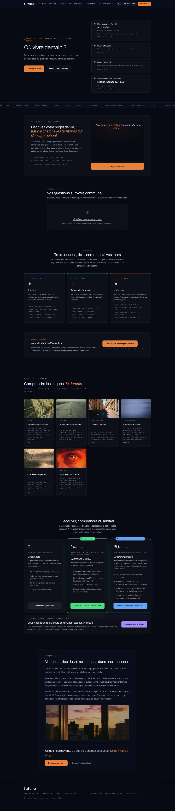 | 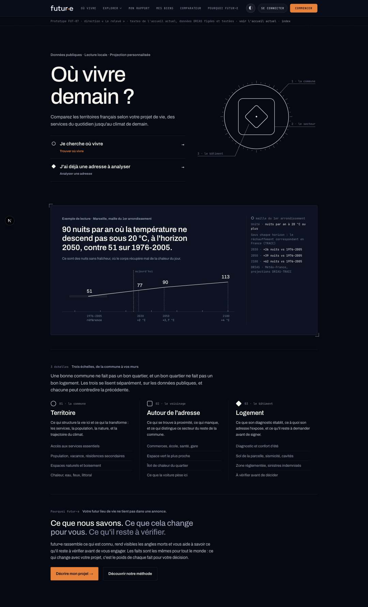 |
| Accueil, 390 px |  | 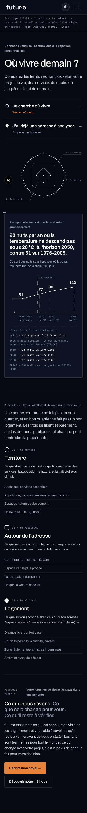 |
| Ma décision, bureau | 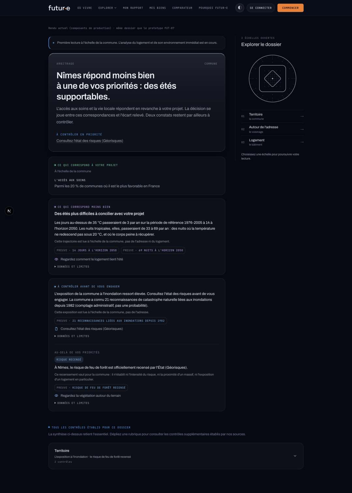 | 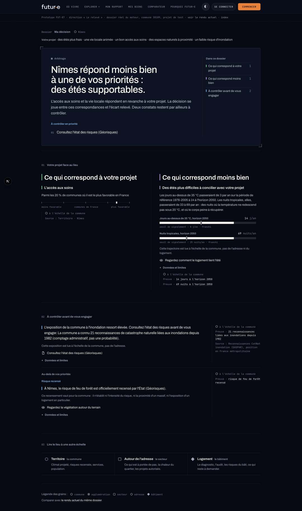 |
| Ma décision, 390 px | 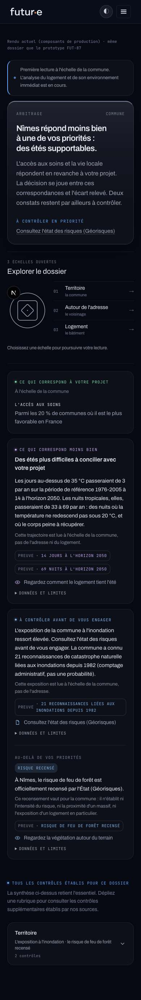 | 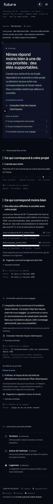 |
| Logement, bureau | 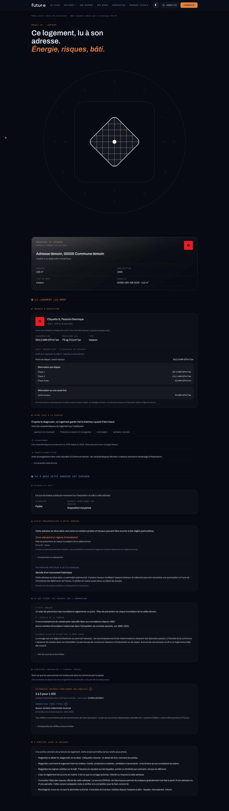 | 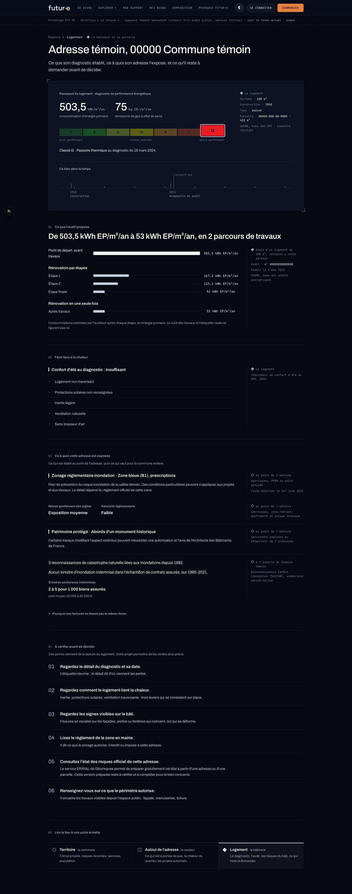 |
| Logement, 390 px | 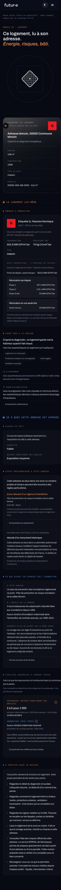 | 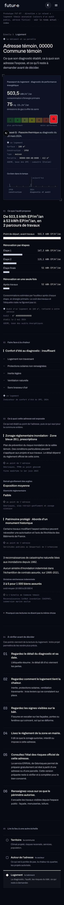 |

360 px : [Ma décision](decision-apres-360.jpg) · [Logement](logement-apres-360.jpg)

Planche des trois directions à contenu égal : 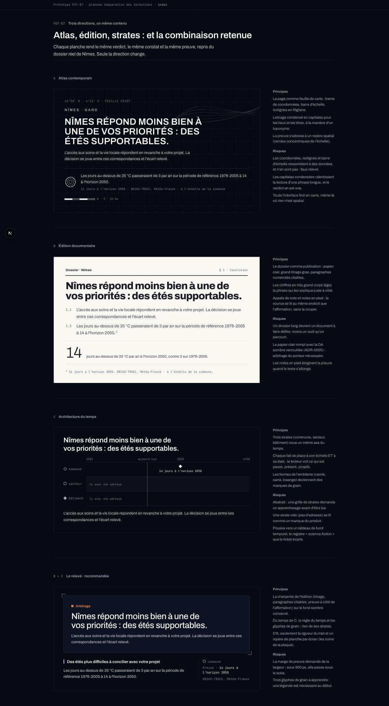
