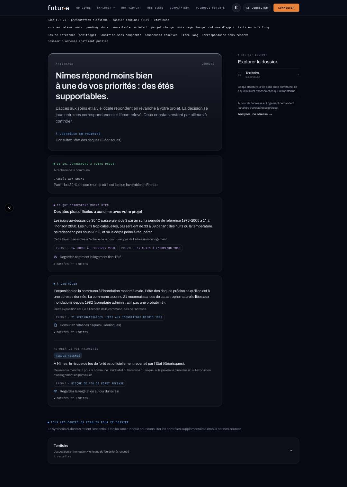
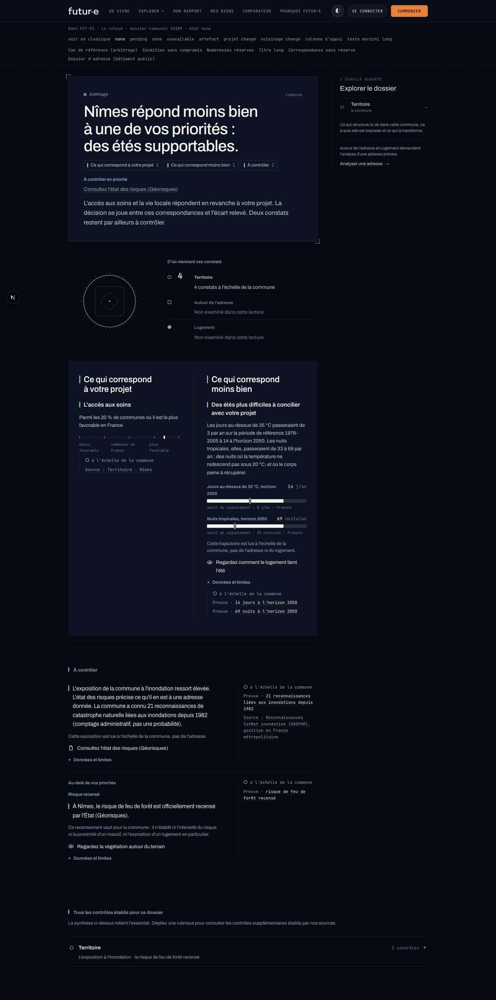
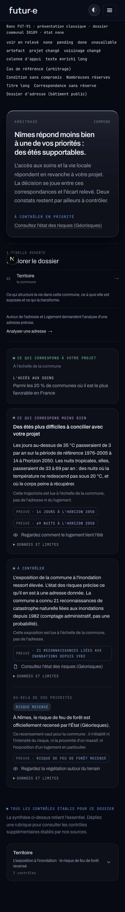
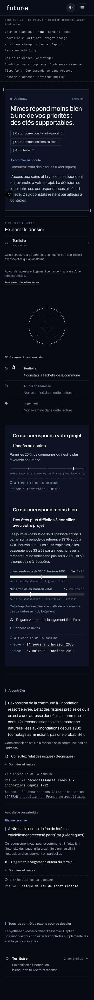
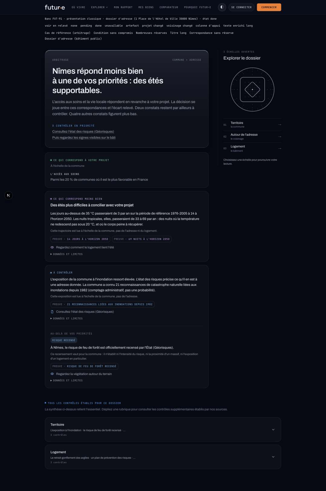
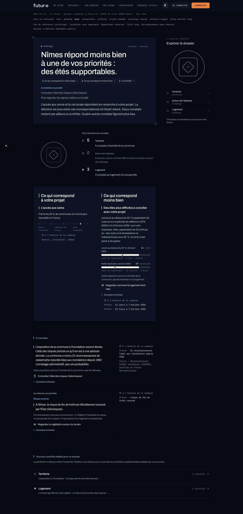
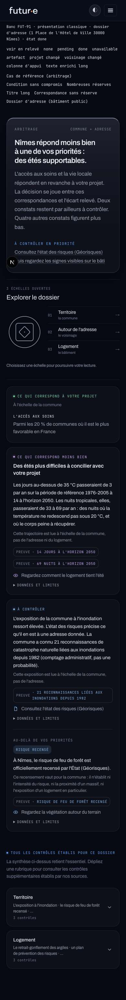
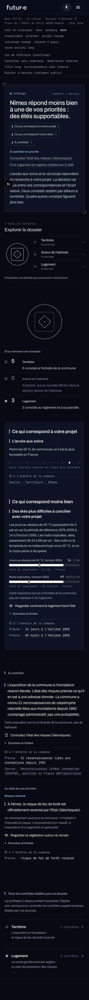
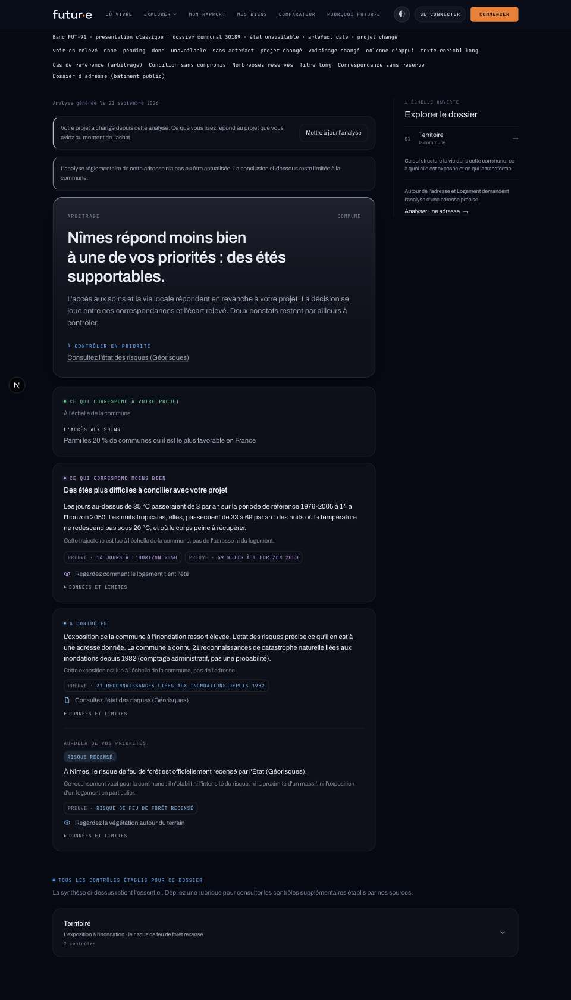
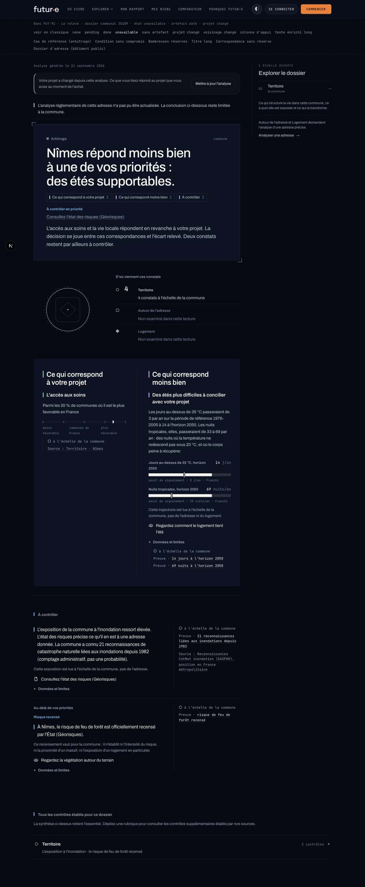

# FUT-91 · Captures avant / après (anonymisées)

Banc `/dev/fut91`, composants de production, `DOSSIER_NARRATIVE=false` (aucun appel au modèle).
Communes publiques et adresse d'un bâtiment public (hôtel de ville de Nîmes). « Avant » : la
présentation actuelle de production ; « après » : la même page en présentation relevé. Le prototype
FUT-87, troisième état de comparaison, est dans `../fut87-captures/` (`decision-apres-*`).

| Cas | Avant | Après |
| --- | --- | --- |
| Dossier communal, colonne d'appui, 1440 |  |  |
| Dossier communal, 390 |  |  |
| Dossier d'adresse réel, 1440 |  |  |
| Dossier d'adresse réel, 390 |  |  |
| Artefact daté, projet changé, adresse indisponible, laptop 1280 |  |  |

Après seulement : [communal 360](communal-apres-360.jpg) · [adresse 360](adresse-apres-360.jpg) ·
[adresse en cours, 1440](pending-apres-1440.jpg) · [condition ouverte, 1440](condition-apres-1440.jpg) ·
[nombreuses réserves, 390](reserves-apres-390.jpg) · [titre long, 390](titre-long-apres-390.jpg) ·
[texte enrichi long, 1440](enrichi-long-apres-1440.jpg)
