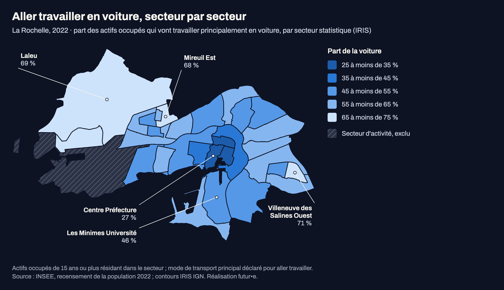

# Visuels de l'article pilote mobilité La Rochelle

Trois visuels, chacun en **quatre fichiers** : version large et version mobile (640 px, textes agrandis), chacune en **thème clair** (fond blanc) et en **thème sombre** (fond `--bg-deep` du site, #0d1322). SVG et PNG (rendu 2x, police Archivo).

| Visuel | Place dans l'article | Large | Mobile |
|---|---|---|---|
| Carte par secteur | Section des quartiers | `carte_iris_17300_{clair,sombre}.svg/.png` (1000 px) | `carte_iris_17300_mobile_{clair,sombre}.svg/.png` |
| Barres selon le lieu de travail | Section « Travailler à La Rochelle, ou juste à côté » | `barres_lieu_travail_{clair,sombre}.svg/.png` (600 px) | `barres_lieu_travail_mobile_{clair,sombre}.svg/.png` |
| Carte de situation des communes du graphique | À côté des barres (même bloc) | `carte_communes_17300_{clair,sombre}.svg/.png` (300 px) | `carte_communes_17300_mobile_{clair,sombre}.svg/.png` |

**Bloc barres + communes (13/10/2026).** La petite carte des communes servait d'encart à la carte des secteurs ; elle est désormais posée **auprès du graphique 44 % / 72 %**, là où le lecteur compare ces communes : côte à côte quand la colonne fait au moins 900 px (600 + 300), l'une sous l'autre en dessous (`flex-wrap`). Mêmes géométries qu'avant. La carte des secteurs n'a plus d'encart.
| Tableau accessible associé à la carte | `tableau_iris_17300.html` (balisage `<table>` avec `<caption>`, `scope`) et `tableau_iris_17300.md` | |

## Intégration selon le thème et la largeur

Le site bascule clair/sombre par `data-theme` : choisir le fichier du thème actif (ou, à défaut, `prefers-color-scheme`). Exemple pour un fond sombre :

```html
<figure>
  <picture>
    <source media="(max-width: 640px)" srcset="carte_iris_17300_mobile_sombre.png">
    
  </picture>
  <figcaption>(légende ci-dessous)</figcaption>
</figure>
```

Chaque thème a **sa propre rampe**, validée sur **sa** surface (`validate_palette.js --ordinal` du skill dataviz) : sur fond clair, plus la part est élevée, plus le bleu est foncé ; sur fond sombre, plus il est lumineux. La légende de chaque fichier suit son thème. Ne pas poser une version claire sur fond sombre, ni l'inverse.

## Carte

**Titre** (dans l'image) : Aller travailler en voiture, secteur par secteur (raccourci : deux lignes au lieu de trois en mobile)

**Légende et texte alternatif** : `legendes.html` (version de référence, à reprendre dans l'article). L'image porte déjà titre, millésime, définition et source ; la légende HTML n'ajoute que ce qui manque (noms INSEE des secteurs, prudence sur les petits écarts), pour ne pas répéter l'image ni le texte (allégée le 13/10/2026). Les textes alternatifs restent complets : ils remplacent l'image.

**Dans l'image** : millésime dans le sous-titre (« La Rochelle, 2022 »), définition courte (actifs occupés de 15 ans ou plus résidant dans le secteur, mode principal déclaré), source (INSEE, recensement 2022 ; contours IGN).

**Choix** :
- Valeurs de la fiche validée (`fiches/17300/fiche.json`, tableau `iris`, identique à `resultats/iris_mobilite_2022.csv`), jointes aux contours IRIS IGN archivés par code IRIS (31/31, noms identiques). Aplats par secteur, sans interpolation ni précision à la rue.
- Cinq classes égales de 10 points (25 à 75 %), une seule teinte : pas d'opposition « bon » / « mauvais ».
- Chef de Baie (IRIS d'activité) hachuré et exclu. La catégorie « Sans donnée exploitable » n'apparaît en légende que si elle est présente (aucun secteur à La Rochelle).
- Cinq libellés : les trois secteurs cités dans l'article (Centre Préfecture, Mireuil Est, Villeneuve des Salines Ouest), Laleu (la plus grande zone foncée, qui sinon intrigue) et Les Minimes Université (repère connu, valeur intermédiaire). Libellés INSEE tels quels ; l'article peut écrire « Villeneuve-les-Salines ».
- Pas d'encart : la situation des communes voisines est donnée à côté du graphique qui les compare (voir ci-dessous). La carte des quartiers reste à pleine largeur.

## Barres

**Titre** : Habiter La Rochelle, travailler ici ou dans une commune voisine

**Sous-titre** : Part utilisant principalement la voiture pour aller travailler, parmi les actifs résidant à La Rochelle, en 2022.

**Largeur** : 600 px en version large (au lieu de 1000) pour tenir à côté de la carte des communes sans réduire les textes.

**Note** (dans l'image, allégée) : Deux groupes distincts de résidents ; l'écart décrit des pratiques. Source : INSEE, recensement 2022. La précision causale complète est dans `legendes.html`.

**Texte alternatif** : voir `legendes.html` (bloc `.bloc-communes`).

**Valeurs** : `resultats/incertitudes_mobpro.csv`, 0,441 et 0,723 (affichées 44 % et 72 %). Le second groupe porte sur les **quatre** communes nommées ; le fait « communes voisines » de la fiche automatique (0,732) inclut aussi Châtelaillon-Plage et n'est pas utilisé ici. Les autres modes ne sont pas ajoutés.

## Carte de situation des communes

**Titre** : Situer les communes du graphique. **Sous-titre** : Les communes de la seconde barre, autour de La Rochelle.

**Choix** : La Rochelle (gris soutenu) et Aytré, Lagord, Périgny, Puilboreau (gris clair, nommées), soit **exactement** le périmètre de la seconde barre, sans Châtelaillon-Plage. Contours communaux obtenus par fusion exacte des contours IRIS officiels IGN déjà archivés ; aucun tracé approximatif, aucune donnée représentée. Libellé de La Rochelle sans « carte ci-contre » : la carte n'est plus voisine de la carte des secteurs.

**Texte alternatif** : voir `legendes.html`.

## Reproduire

Depuis `docs/etudes/2026-10-13-larochelle-mobilite/`, avec l'environnement de `outil/requirements.txt` et Google Chrome (rendu PNG) :

```sh
python visuels/generer_visuels.py --insee 17300 --fiche fiches/17300/fiche.json \
  --contours <checkout>/data/cache-etudes/2026-10-13-larochelle-mobilite/cache-outil/iris_ign_17300.json \
  --incertitudes resultats/incertitudes_mobpro.csv --out visuels
```

La carte des communes lit les contours `iris_ign_<insee>.json` des communes à situer dans le même dossier que `--contours` ; défaut pour 17300 : `--communes 17200,17291,17274,17028` (le périmètre de la seconde barre). `--communes ""` ne la produit pas.

Autre commune : produire d'abord sa fiche (`outil/fiche_mobilite.py`), puis passer `--insee`, `--fiche`, `--contours` (fichier `iris_ign_<insee>.json` du cache de l'outil) et, au besoin, `--libelles CODE,CODE` (libellés posés au centre des secteurs, à replacer à la main si besoin). Le script s'arrête avec un message clair si la commune n'est pas découpée en IRIS d'habitat, ou si une valeur sort des classes (25 à 75 % par défaut ; `--classes 0.45` les décale, de 45 à 95 %, comme il faut pour Niort). Le graphique en barres n'est produit que pour La Rochelle ; `--communes CODE,…` produit une carte de situation dont le sous-titre parle de « la seconde barre » : sans graphique, elle n'a pas lieu d'être. Texte alternatif de la carte : bornes, extrêmes et secteurs exclus tirés des données. `--sans-png` saute le rendu Chrome.

## Limites utiles

- Une IRIS de moins de 300 actifs (Mireuil Château d'Eau) est affichée sans traitement particulier : précision de quelques points, comme les autres ; la note le rappelle.
- Les SVG chargent Archivo depuis Google Fonts ; hors ligne, ils retombent sur Helvetica Neue / Arial (largeurs proches, mise en page vérifiée avec Archivo).
- Les positions des libellés de La Rochelle sont réglées à la main pour ces contours ; elles ne se transposent pas à une autre commune.

## Niort (79191) · article de la rédaction autonome, essai 2 édité

Dossier `visuels/79191/` : carte par secteur et graphique selon le lieu de travail, large et mobile, clair et sombre, SVG et PNG ; tableau accessible des secteurs ; `legendes.html` (légendes et textes alternatifs, lus par `/dev/article-niort`). Le tableau du scénario carburant est un tableau Markdown dans l'article.

- **Carte** : classes de 45 à 95 % (`--classes 0.45`). Libellés des sept secteurs cités (`LIBELLES_79191`) : Centre et Saint-Liguaire-Nantes au centre de leur secteur, les voisins du Centre reportés dans les marges libres avec trait de rappel sans croisement, Surimeau-Antes Cholette accroché à un point intérieur (son centroïde tombe hors du secteur en croissant).
- **Graphique** : trois barres lues dans la fiche (`mobpro.voiture_selon_destination`) : Niort 65 %, Chauray, Aiffres ou Bessines 85 %, ailleurs 87 %. Même présentation que La Rochelle ; seule la source des valeurs change (`groupes_barres`). Pas de carte de situation.
- Vérifié : les SVG de La Rochelle régénérés après ces changements sont identiques octet pour octet aux fichiers versionnés.

```sh
python visuels/generer_visuels.py --insee 79191 --fiche fiches/79191/fiche.json \
  --contours <checkout>/data/cache-etudes/2026-10-13-larochelle-mobilite/cache-outil/iris_ign_79191.json \
  --classes 0.45 --communes "" --out visuels/79191
```
